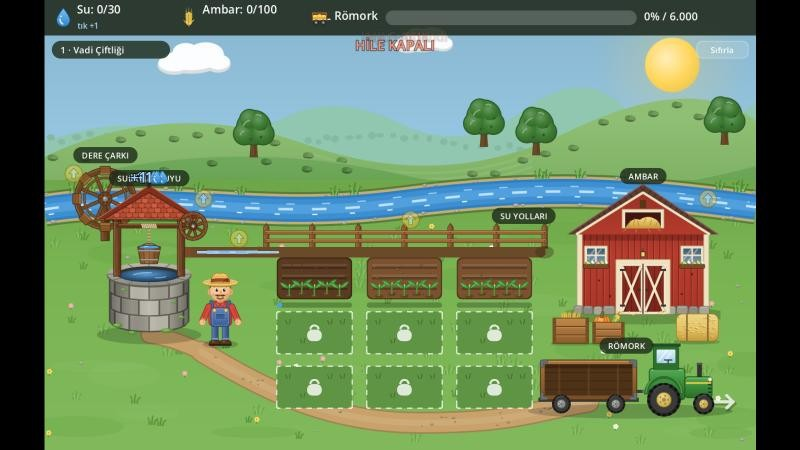
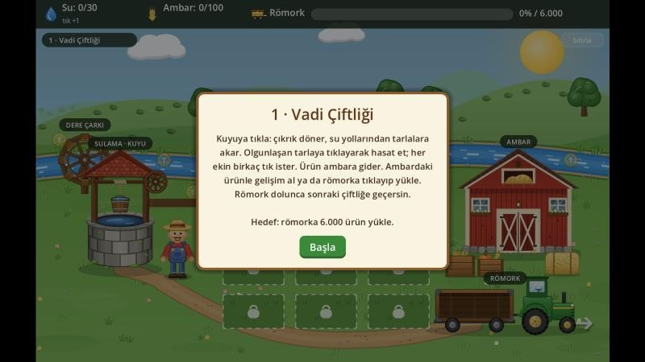
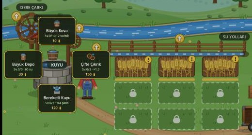

# Kuyu Başı — Çiftlik Clicker

Kuyudan su çek, kanallarla tarlaları sula, hasadı ambara topla, römorku doldur ve kuralları farklı olan bir sonraki çiftliğe taşın.

> 🔒 Kaynak kod şimdilik kapalı. Oyunu [Releases](https://github.com/HalittBulut/kuyu-basi/releases/latest) sayfasından indirip oynayabilirsin.

## Oynanış

| Başlangıç | Yükseltme menüsü |
|---|---|
|  |  |

- **Su akışı simülasyonu:** kuyudan çekilen su önce depoya girer, sonra kanallarda akıntı gibi ilerler. Büyüyen tarlalar yanlarından geçen sudan emer.
- **Hasat:** olgun tarlaya her tık hasat gücü kadar işler. Buğday, mısır ve balkabağının hasat süreleri farklıdır.
- **Yuvarlak yükseltme menüsü:** kuyu, dere çarkı, kanal, tarla ve ambarın her birinin kendi gelişim ağacı var.
- **Yardımcı çiftçiler:** seviye atladıkça ambardan çıkıp olgun tarlaları kendileri biçer.
- **Üç çiftlik, üç kural:**

| Çiftlik | Kural |
|---|---|
| Vadi | Normal |
| Tepe | Dere yok, ara sıra yağmur yağar |
| Kuru Ova | Dere yok, kanaldaki su buharlaşır |

Tamamlanan her çiftlik kalıcı bir **Tecrübe** bonusu verir.

## İndir ve oyna

- **Windows:** [Releases](https://github.com/HalittBulut/kuyu-basi/releases/latest) sayfasından `KuyuBasi-Windows.zip` dosyasını indir, içindeki `KuyuBasi.exe` dosyasını çalıştır.
- **Web:** `KuyuBasi-Web.zip` itch.io gibi bir sitede doğrudan çalışacak şekilde derlendi.

## Durum

Oynanabilir sürüm hazır. Denge ayarları ve yeni içerik üzerinde çalışılıyor.

## Teknik

- **Veri odaklı mimari:** yeni ekin, gelişim ya da çiftlik eklemek için kod yazmak gerekmez, ilgili klasöre bir `.tres` kaynağı koymak yeterli. Oyun açılışta klasörü tarar.
- **Denge botu:** Vadi çiftliğini otomatik oynayıp ekonomi dengesini ölçen test sahnesi
- Oyun mantığı testleri ve otomatik kayıt sistemi
- Tek komutla görsel ve ses üretimi, testler ve iki derleme: itch.io uyumlu web ve Windows
- Görseller ve ses efektleri betiklerle üretiliyor

---

Geliştiren: [Halit Bulut](https://github.com/HalittBulut)
